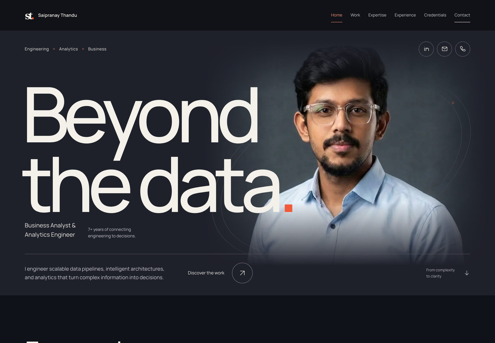

# Saipranay Thandu — Portfolio

**Beyond the data.**

I work where data engineering, analytics, and business decisions meet. This portfolio makes that work visible: follow a pipeline, explore a semantic model, and see how raw information becomes something people can use.



## The experience

The site opens with a brief signal sequence and an editorial portrait. A replayable **Noise to Knowledge** scene brings scattered information into structure. Both sequences respect reduced-motion preferences; the opening can also be skipped with input.

At the center is a seven-stage architecture explorer, from sources and ingestion through Bronze, Silver, Gold, a semantic layer, and business decisions. Selecting a stage changes its explanation, tools, and related work. The selection is reflected in the URL, and the controls support keyboard navigation.

The optional schema view goes a level deeper: district and program filters intersect over a small synthetic dataset, recalculate the displayed measures, and expose the underlying DAX. These examples illustrate model behavior; they contain no private employer or project records.

Technology and career sections use focused, selectable views. Three visual stories connect the architecture to professional work, with dedicated case-study pages for the details.

## Three engineering stories

- **Enterprise Geospatial Pipeline Engineering** — spatial data moves through ingestion, alignment, validation, and publication. The story connects Python, Oracle SQL, ArcPy, and spatial ETL to repeatable delivery.
- **Project Delivery & Financial Intelligence** — project, schedule, and funding information becomes a semantic model for portfolio analysis. The visual follows the transition from fragmented records to measures and decisions.
- **Workforce Qualification Intelligence** — qualification records are normalized, matched, and reviewed for exceptions. The emphasis is on making coverage and gaps understandable.

The diagrams explain the work without reproducing internal systems. Reported professional outcomes and the interactive demonstration data are kept separate.

## Technology and structure

The application lives in [`site/`](site). It uses **Next.js 16 App Router, React 19, TypeScript, Tailwind CSS 4, and Motion**. Page composition stays in Server Components; interactive scenes and controls use client components. Typed content and model data live in `site/src/data`, separate from presentation.

SVG carries the architecture and story illustrations. React state drives selections and filters, while CSS and Motion handle transitions. This keeps the visual explanations close to the content without adding a canvas engine or a backend. Manrope and Fraunces are served locally through `next/font/local`; the portrait uses Next Image.

The repository includes metadata, a generated social image, sitemap and robots routes. Search indexing remains disabled until `NEXT_PUBLIC_SITE_URL` supplies the intended public origin. There is no database, authentication service, or form-processing service to configure.

## Run locally

Use **Node.js 22 or newer** and npm. Access to the private repository is required to clone it.

```sh
git clone https://github.com/thandu9/saipranay-portfolio.git
cd saipranay-portfolio/site
npm ci
npm run dev
```

Open [localhost:3000](http://localhost:3000). No environment variables are required for local development.

For a static production build and local preview (the preview command requires Python 3):

```sh
npm run build
python3 -m http.server 3000 --directory out
```

GitHub Pages uses the existing `.github/workflows/nextjs.yml`. It installs dependencies in `site/`, builds with the Pages origin and base path, and deploys `site/out`. For a manual build under a subpath, set both `NEXT_PUBLIC_BASE_PATH` and `NEXT_PUBLIC_SITE_URL` before building and serve the export at that subpath. Do not commit local environment files.

## Checks

From `site/`:

```sh
npm run lint
npm run typecheck
npm test
```

With the application running on port 3000, install the browser binaries and run the Chromium and WebKit checks:

```sh
npx playwright install chromium webkit
npm run test:e2e -- --project=chromium --project=webkit
```

The suite covers navigation, model filtering, keyboard interactions, responsive layouts, reduced motion, and automated accessibility checks on selected pages. Firefox is configured separately but is not included in the verified local browser run.

## About

I’m Saipranay Thandu, a Business Analyst and Analytics Engineer with 7+ years across data engineering, business intelligence, financial analytics, enterprise GIS, and business analysis. I hold a master’s in Business Analytics from Sacred Heart University and the Microsoft Fabric Analytics Engineer Associate certification.

[GitHub](https://github.com/thandu9) · [LinkedIn](https://www.linkedin.com/in/saipranaythandu) · [Email](mailto:thandusaipranay@gmail.com)

## License and assets

No project-wide open-source license has been selected. The portrait and portfolio content are personal assets, not a reusable asset library. Included fonts retain their SIL Open Font License notices; see [third-party notices](THIRD_PARTY_NOTICES.md).
